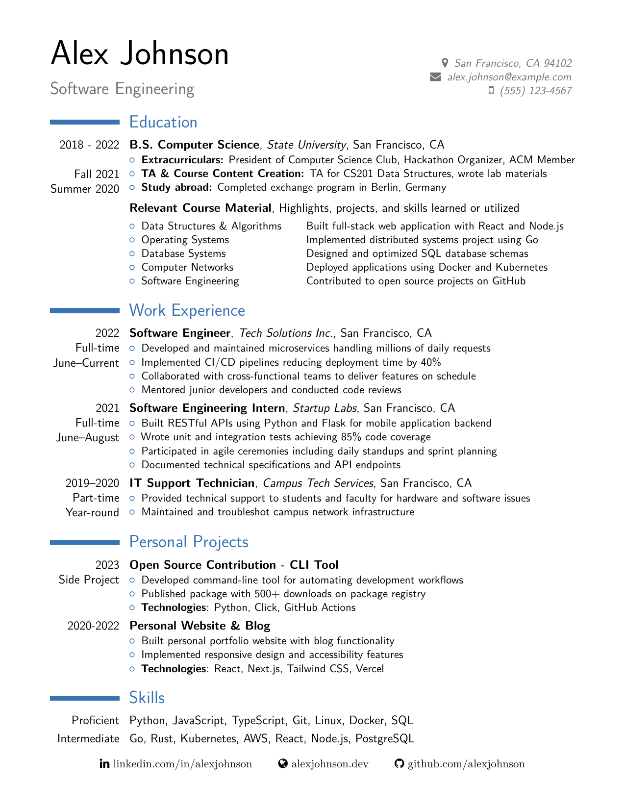

# Resume LaTeX Template

A LaTeX resume template based on an old fork of [moderncv](https://github.com/xdanaux/moderncv).

## Background

This repository exists as an archive of my personal resume template—a fork of a colleague's fork of moderncv that I used to land a job at Google in 2019.

The original setup was a mess. I was new to LaTeX, so nothing was portable. Whenever I hosted resume workshops with my fraternity or helped friends, sharing the template was a nightmare. I eventually resorted to running the whole thing inside a Windows 10 VirtualBox VM, which I carried across machines and operating systems for years.

**I've since cleaned everything up**—it's now portable and easy to set up on any Linux system with TeX Live.

The included sample contains fictional data to demonstrate the layout—my actual resume is not included.

**This repo is largely unsupported.** For active development, consider the modern fork at [github.com/moderncv/moderncv](https://github.com/moderncv/moderncv).

## Fork Additions

This fork is based on the **classic** style (`\moderncvtheme[blue]{classic}`) as it existed in ~2018 or earlier, with customizations:

- **Font Awesome icons** — Uses the `fontawesome` LaTeX package for modern icons throughout the header and footer (`\faMapMarker`, `\faMobile`, `\faEnvelope`, `\faLinkedin`, `\faGithub`, `\faGlobe`)
- **Clickable footer links** — Social links (LinkedIn, GitHub, website) moved to a footer section instead of the header, keeping the header compact
- **Clickable email** — Email addresses automatically link with `mailto:` for one-click compose
- **Cleaner text extraction** — The footer-based social links produce cleaner PDF text extraction for ATS/LLM parsing compared to icon-heavy headers
- **Note:** Phone numbers are displayed as plain text (no `tel:` link)

**Available colors** (default moderncv options): `black`, `blue`, `green`, `grey`, `orange`, `purple`, `red`. Change in `docstyle.sty`:
```latex
\moderncvtheme[orange]{classic}  % or any color above
```

The modern [moderncv](https://github.com/moderncv/moderncv) project still offers a `classic` style (`\moderncvstyle{classic}`), but it places all social links in the header with icons. This fork's approach of using a footer for social links results in better machine readability.

## Sample Output



[Download PDF](sample/sample-resume.pdf)

## Quick Setup (Debian/Ubuntu)

Run the setup script to install dependencies and prepare your workbench:

```bash
./setup.sh
```

This will:
- Install TeX Live packages
- Create `workbench/` and `output/` directories
- Copy sample files to your workbench

## Manual Setup

If you prefer to set up manually:

### 1. Install dependencies

```bash
sudo apt-get install texlive-latex-base texlive-latex-extra texlive-fonts-extra texlive-xetex
```

### 2. Set up your workbench

```bash
mkdir -p workbench output
cp sample/sample-resume.tex workbench/resume.tex
cp sample/sample-docstyle.sty workbench/docstyle.sty
ln -s ../moderncv workbench/moderncv
sed -i 's/sample-docstyle/docstyle/' workbench/resume.tex
```

### 3. Edit your information

Edit `workbench/docstyle.sty` to change:
- Name (`\firstname` and `\familyname`)
- Title/field (`\title`)
- Address (`\address`)
- Phone (`\extrainfo`)
- Email (`\email`)

Edit `workbench/resume.tex` to add your:
- Education
- Work experience
- Projects
- Skills
- Links (LinkedIn, GitHub, website)

### 4. Compile your resume

```bash
./build.sh MyResume
```

Your compiled resume will be at `output/MyResume.pdf`.

The build script sets `TEXINPUTS` to use the local moderncv fork, avoiding conflicts with the system-installed moderncv package (which uses fontawesome5 instead of fontawesome v4).

## Project Structure

```
├── README.md
├── .gitignore
├── setup.sh                # Setup script (run this first)
├── build.sh                # Build script (compiles workbench/resume.tex)
├── moderncv/               # moderncv fork (LaTeX document class)
├── sample/                 # Sample template with fictional data
│   ├── sample-resume.tex   # Sample resume content
│   ├── sample-docstyle.sty # Sample personal info & styling
│   └── sample-resume.pdf   # Pre-compiled sample output
├── workbench/              # Your working area (gitignored, created by setup.sh)
│   ├── resume.tex          # Your resume content
│   ├── docstyle.sty        # Your personal info & styling
│   └── moderncv -> ../moderncv  # Symlink
└── output/                 # Your compiled PDFs (gitignored, created by setup.sh)
```

## License

Based on moderncv, distributed under the LaTeX Project Public License v1.3c.
